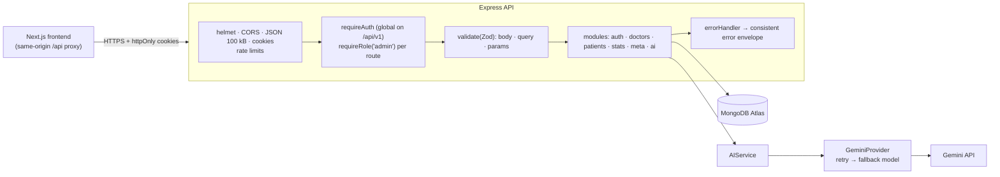

# Doctor Tracker — Backend API

**A REST API for an AI-assisted doctor and patient management portal.** It is built with Express 5, TypeScript and MongoDB: 10,000 seeded patients, indexes designed for each screen, secure cookie-based auth with roles, aggregation-based dashboard stats, and a Gemini AI layer whose output the code always validates.

| | |
|---|---|
| **Live API** | https://doctor-tracker-api-x871.onrender.com/api/v1/health |
| **Live app** | https://doctor-tracker-frontend-bay.vercel.app |
| **Frontend repo** | https://github.com/Rza-O/doctor-tracker-frontend (screenshots and UI decisions are there) |

> The API runs on Render's free tier, so the first request after it has been idle can take about 30–50 s while it wakes up.

---

## Tech stack

| Area | Choice |
|---|---|
| Runtime | Node.js 22, **Express 5**, **TypeScript** (run with `tsx` in dev, compiled with `tsc` for production) |
| Database | **MongoDB Atlas** with **Mongoose 8** |
| Validation | **Zod 4** for env, request bodies, query strings and AI output |
| Auth | JWT access and refresh tokens in **httpOnly cookies**, bcrypt |
| Security | helmet, CORS limited to the frontend's origin, express-rate-limit, 100 kB body limit |
| AI | **Google Gemini** (`@google/genai`) with structured JSON output, behind a provider interface |
| Hosting | **Render** (API) and MongoDB Atlas M0 |

---

## Getting started (local)

**Prerequisites:** Node.js 22 (see `.node-version`) and a MongoDB connection string. A free Atlas M0 cluster works, and so does a local `mongod`.

```bash
git clone https://github.com/Rza-O/doctor-tracker-backend.git
cd doctor-tracker-backend
npm install
cp .env.example .env     # fill in the values, see below
npm run seed             # creates 2 demo users, 100 doctors and 10,000 patients
npm run dev              # http://localhost:4000/api/v1/health
```

Then start the [frontend](https://github.com/Rza-O/doctor-tracker-frontend) with `API_URL=http://localhost:4000`.

> **Seeding is part of setup.** `npm run seed` wipes and rebuilds the database, so it can be re-run any time. It uses a fixed random seed, so the data has the same shape on every machine, and dates are relative to today, so the dashboard always shows recent activity. It refuses to run with `NODE_ENV=production` unless you pass `--force`.

### Environment variables (`.env.example`)

`src/config/env.ts` validates every variable with Zod at startup. A missing or malformed value stops the server with a clear message instead of failing later.

| Variable | Purpose |
|---|---|
| `NODE_ENV`, `PORT` | `development` / `production` and the port (default 4000) |
| `CLIENT_ORIGIN` | The frontend origin allowed by CORS |
| `MONGODB_URI` | Atlas connection string. Use a database user with `readWrite` on this database only. |
| `MONGODB_DB_NAME` | Database name (default `doctor_tracker`) |
| `JWT_ACCESS_SECRET`, `JWT_REFRESH_SECRET` | Two *different* random strings of at least 32 characters each |
| `JWT_ACCESS_EXPIRES_IN`, `JWT_REFRESH_EXPIRES_IN` | Defaults `15m` and `7d` |
| `SEED_ADMIN_EMAIL` / `_PASSWORD`, `SEED_VIEWER_EMAIL` / `_PASSWORD` | The demo accounts that `npm run seed` creates (only the seed script reads these) |
| `AI_PROVIDER` | `gemini` or `none`. With `none`, or with no key, AI endpoints return `503 AI_DISABLED` and the frontend hides AI features. |
| `GEMINI_API_KEY` | From Google AI Studio |
| `GEMINI_MODEL`, `GEMINI_FALLBACK_MODEL` | Defaults `gemini-3.1-flash-lite` and `gemini-3.5-flash-lite` (see [AI layer](#ai-layer)) |
| `AI_TIMEOUT_MS` | Timeout per attempt (default 8000) |

### Scripts

| Command | |
|---|---|
| `npm run dev` | Watch mode with `tsx` |
| `npm run build` / `npm start` | Compile to `dist/` and run |
| `npm run typecheck` | `tsc --noEmit` |
| `npm run seed` | Rebuild the demo database |
| `npm run ai:eval` | Run the Ask prompt against 17 labelled cases and report accuracy and latency (needs a Gemini key) |

---

## Architecture



```
src/
├── app.ts / server.ts     # App wiring (middleware order, routes) and startup/shutdown
├── config/                # env.ts (Zod-validated env), db.ts (connection)
├── middleware/            # auth (requireAuth, requireRole), validate, rateLimit, errorHandler
├── models/                # User, Doctor, Patient + plugins/searchableName (word-prefix search)
├── modules/<domain>/      # routes → controller → service (+ schema.ts for Zod)
│   └── ai/                # ai.service, gemini.provider, ai.search, ai.insights, ai.intake
├── utils/                 # ApiError, paginate, cache, tokens, password, query schemas
└── scripts/               # seed/ (deterministic data generator), ai-eval.ts
```

Each module is split into routes (HTTP wiring), a controller (request and response) and a service (business logic and queries), so every layer can be tested and changed on its own.

**Response envelope**, the same for every endpoint:
```json
{ "success": true, "data": { ... } }
{ "success": false, "error": { "code": "VALIDATION_ERROR", "message": "…", "details": { "fieldErrors": { … } } } }
```

---

## API

Base path: `/api/v1`. Every route except health and auth needs a valid session. Write routes need the **admin** role.

| Method | Path | Access | Notes |
|---|---|---|---|
| GET | `/health` | public | Liveness check (used by Render) |
| POST | `/auth/login` | public | 10 attempts per 15 min per IP. Sets the access and refresh cookies. |
| POST | `/auth/refresh` | refresh cookie | Rotates both tokens |
| POST | `/auth/logout` | public | Bumps `tokenVersion` (ends sessions on every device) and clears cookies |
| GET | `/auth/me` | user | Current user |
| GET | `/meta` | user | Specializations, hospitals, conditions (for filter options) |
| GET | `/doctors` | user | `page, limit, search, specialization, hospital, from, to, sort` |
| POST | `/doctors` | admin | Create a doctor |
| GET | `/doctors/:id` | user | Doctor with patient count |
| GET | `/doctors/:id/patients` | user | Same filters as `/patients`, scoped to this doctor |
| POST | `/doctors/:id/patients` | admin | Add a patient to this doctor |
| GET | `/patients` | user | `page, limit, search` (name, or email if it contains `@`), `condition, severity, status, gender` (comma-separated), `ageMin, ageMax, from, to, doctor, sort` |
| GET | `/patients/:id` | user | |
| PATCH | `/patients/:id` | admin | Partial update |
| DELETE | `/patients/:id` | admin | |
| GET | `/stats?range=30d\|90d\|12m` | user | KPIs plus breakdowns for the period, cached for 60 s |
| GET | `/ai/status` | user | `{ enabled, provider }`, which the frontend uses to show or hide AI |
| POST | `/ai/search` | user | `{ query, scope: patients\|doctors }` returns `{ filters, explanation, unsupported }`. 20/min per user. |
| GET | `/ai/insights?range=…&refresh=0\|1` | user | 2–5 grounded insights, cached 10 min. 10/min per user. |
| POST | `/ai/intake` | admin | `{ note }` returns `{ fields, missing, warnings }`. 10/min per user. |

Lists return `{ items, page, limit, total, totalPages }`. `limit` is capped at 100. Sorting is restricted to an allowlist per resource, and a unique tie-breaker field keeps page order deterministic.

---

## Database design & optimization

**Collections.**
- **Users**: email, bcrypt hash, role, `tokenVersion`.
- **Doctors**: name, specialization, hospital, contact, `createdAt` (used as "joined").
- **Patients**: name, age, gender, contact, condition, severity, status, admission date, and a `doctor` ObjectId reference.

Patients *reference* doctors rather than being embedded inside them. A doctor can have hundreds of patients, and patients are queried globally across doctors.

**Indexes follow the ESR rule (Equality → Sort → Range)**, one for each real screen:

| Index | Serves |
|---|---|
| `patients { doctor, admissionDate: -1 }` | Doctor page patient list (newest first), patients-per-doctor aggregation |
| `patients { doctor, condition, admissionDate: -1 }` | Doctor page filtered by condition |
| `patients { condition, admissionDate: -1 }`, `{ severity, admissionDate: -1 }` | Patients page filters |
| `patients { admissionDate: -1 }` | Default sort, date-range filter, time-series chart |
| `patients { email }` | Email prefix search |
| `doctors { createdAt: -1 }`, `{ specialization, createdAt: -1 }`, `{ hospital }` | Doctors list, filters, "joined between" |
| `{ nameTokens }` (both) | Word-prefix name search |

**Search.**
- A Mongoose plugin stores the lowercased words of each name in `nameTokens`, which has a multikey index. Searching "rahm" runs an anchored, escaped regex on that index, so it matches any word of the name, last names included.
- `explain()` shows `IXSCAN` with 20 documents examined for 20 returned. There is no collection scan.
- An unanchored `/rahm/i` would scan every document. Atlas Search is the next step for typo tolerance.

**Other optimizations.**
- The page query and `countDocuments` run **in parallel**. An unfiltered count uses `estimatedDocumentCount` (metadata, O(1)).
- `.lean()` on reads, so there is no per-row Mongoose document overhead. The doctor list gets its patient counts from **one** grouped aggregation for the whole page, not one query per doctor.
- Dashboard stats: time buckets use the **Asia/Dhaka** time zone, and missing days are filled so the series has no gaps. "New this month" is compared with the *same number of days* of last month, not the whole month. The result is cached in memory for 60 s, and the cache stores the *promise*, so concurrent requests share one computation (first call ≈370 ms, cached ≈3 ms).

---

## Technical decisions

### 1. Dashboard stats: parallel focused aggregations instead of one big `$facet`

**Context.** One dashboard request needs about eight different results:
- totals
- this month vs last month
- an admissions time series
- breakdowns by condition, severity and status
- top doctors
- workload per specialty

The obvious way is a single aggregation whose `$facet` stage computes everything in one round trip.

**Decision.** Run small, focused queries **concurrently** with `Promise.all`, each shaped to use the best index. `$facet` is used only where it really helps.

**Why.**
- **`$facet` sub-pipelines can't use indexes.** They all work on whatever documents enter the facet. Putting everything in one facet means reading every patient, even for the counts that could have been answered from the `admissionDate` index range.
- Separate queries each pick their own index. Running them concurrently, the total time is about the slowest query, not the sum of all of them.
- `estimatedDocumentCount()` answers the totals from collection metadata, without reading any documents.
- **Where `$facet` *is* used, on purpose:**
  - The condition, severity and status breakdowns all need the same set of patients: the period's, selected first by an indexed `$match`. So one shared pass beats three scans.
  - Patients are grouped by doctor *once* (10,000 rows → about 100). Only those ~100 rows are joined to doctors with `$lookup`, and a `$facet` then produces both "top 10 doctors" and "per specialty".
- Small functions are readable and testable on their own, and the AI insights feature reuses them directly.

**Trade-off.** Several round trips to the database instead of one, and more code to read. The 60 s promise cache makes the cost negligible. At much larger scale I'd pre-compute daily rollups into a summary collection (`$merge` on a schedule).

### 2. Name search: word tokens on a multikey index instead of `$regex` or a `$text` index

**Context.** Users type part of a name ("rahm") and expect matches on *any* word, last names included, while 10,000+ records stay fast.

**Options.**
- **Unanchored `$regex` (`/rahm/i`).** Simplest, but it can't use an index, so every search scans the whole collection.
- **A `$text` index.** Indexed, but it matches whole stemmed words, **not prefixes**, so "rahm" doesn't find "Rahman". It also allows only one text index per collection.
- **Anchored regex on `name`.** Indexed, but it matches only the *first* word.
- **Atlas Search.** Best quality (fuzzy matching, autocomplete), but tied to Atlas and more setup.

**Decision.** A small Mongoose plugin stores the lowercased words of each name in `nameTokens`, which has a multikey index. Each search word becomes an **anchored, regex-escaped prefix** query on that array, and every word must match.
- The plugin has a document hook for create and save, and a query hook for `findOneAndUpdate` and `updateOne`, because document hooks don't run on query updates.
- `nameTokens` is hidden from API responses.

**Result.** "rahm" finds every "… Rahman" by last name. "farhana rah" narrows to people matching both words. `explain()` shows `IXSCAN` with 20 documents examined for 20 returned. Regex characters such as `.*` are escaped and treated as plain text.

**Trade-off.** There's no typo tolerance, and the stored token array adds a little to each document. The next step is Atlas Search.

---

## Security

- **Tokens.**
  - A 15-minute access token and a 7-day refresh token, signed with different secrets.
  - Both are httpOnly cookies with `Secure` and `SameSite=Lax` in production. The refresh cookie is sent only to `/api/v1/auth`.
  - Every refresh rotates both tokens.
- **Revocation.** Each user has a `tokenVersion` that is embedded in the tokens. Logout increments it, which invalidates every refresh token for that user at once.
- **Passwords.**
  - bcrypt with cost 10. Older hashes are upgraded transparently on login.
  - Login runs a hash comparison even for unknown emails, so response timing doesn't reveal which emails exist, and it always returns a generic error.
- **Secure by default.** `requireAuth` is mounted once on `/api/v1` after the public routes, so a new route can't be left unprotected by accident. `requireRole('admin')` guards every write.
- **Input.** Every body, query and params object is parsed with Zod. Unknown sort fields, malformed ObjectIds and oversized strings are rejected with `400 VALIDATION_ERROR` and field-level details. Search text is regex-escaped.
- **Rate limits** for login, and per-user limits on AI endpoints. There are also helmet headers, a CORS allowlist and a 100 kB body limit.

---

## AI layer

**Design: the model proposes, the code verifies, and a person decides.**

```
feature (search / insights / intake)
  → AIService.generateValidated(request, zodSchema)
      → AIProvider (GeminiProvider today; Claude/OpenAI = one new class)
          → structured JSON output (responseJsonSchema generated from the Zod schema)
      → Zod re-validation → feature-specific checks → response
```

- **Provider interface.** Feature code never imports the Gemini SDK. Switching provider means implementing one `generateJson()` method.
- **Structured output.** The JSON schema sent to Gemini is generated from the same Zod schema that validates the reply (`z.toJSONSchema`), so they can't drift apart.
- **Resilience.** The provider tries the primary model, retries it once after 400 ms, then tries the fallback model. Each attempt has an 8-second timeout. If all of them fail, it returns `503 AI_UNAVAILABLE` and the UI keeps the manual filters.
  - The models were **chosen by benchmark**: I listed the models the key can use and measured latency and failure rate on a realistic request.
  - `gemini-2.5-flash` turned out to be retired (404), which is why the fallback is also used on a 404.
- **Observability.** Each call logs the feature, model, latency, token counts, whether the fallback was used, and the outcome. It **never logs user text**, because that can contain patient details.
- **Prompt injection.** User text is wrapped in delimiters and treated as data. The model can only return JSON matching a closed schema, and the server validates it again. The output is filters, never queries or commands.

| Feature | Safeguards beyond the schema |
|---|---|
| **Ask** (`/ai/search`) | Field-level schema descriptions with synonyms. Filters come before the explanation in the output, which was measured to be more accurate. Post-processing drops empty, impossible or future values, swaps reversed ranges, and reports the parts it couldn't express as `unsupported`. **`npm run ai:eval`: 17/17 cases, median ≈1.3 s.** |
| **Insights** (`/ai/insights`) | The model sees **only aggregates for the period, with percentages already computed**, never patient records. A **grounding check** drops any insight that quotes a count or percentage not found in the input, including percentages written as words. Cached 10 min; `refresh=1` regenerates. |
| **Smart intake** (`/ai/intake`) | Admin only. The prompt says to extract only what is explicit and to ignore the referring doctor's details. The server then checks phone format, email validity and that the date is not in the future. A field that fails is dropped with a warning. The response lists the `missing` required fields. **It never saves anything**: the frontend only pre-fills the form for review. |

**Privacy trade-off.** This demo uses the **free Gemini tier, where Google may use prompts to improve its products.**
- Ask sends the question text, and intake sends the pasted note. Insights send aggregates only.
- All demo data is fictional, and the UI warns before intake sends a note.
- In production I would use a paid or enterprise tier with no training on customer data and a signed data processing agreement (DPA, or a BAA in the US). I'd also redact identifiers before sending.
- `AI_PROVIDER=none` turns the AI layer off completely.

---

## Trade-offs & next steps
- **In-memory cache.** It's simple and enough for one instance. With several instances I'd use Redis, or invalidate on writes through a shared channel.
- **Offset pagination.** It suits "jump to page N" at this scale. For very deep pages I'd use cursor pagination.
- **Tests.** I verified behaviour with scripted HTTP checks, `explain()` plans and the AI eval. Next I'd add Jest and Supertest integration tests against `mongodb-memory-server`, and run them in CI.
- **Product.** An audit log for patient changes, soft delete, and doctor edit and delete with reassignment of their patients.
